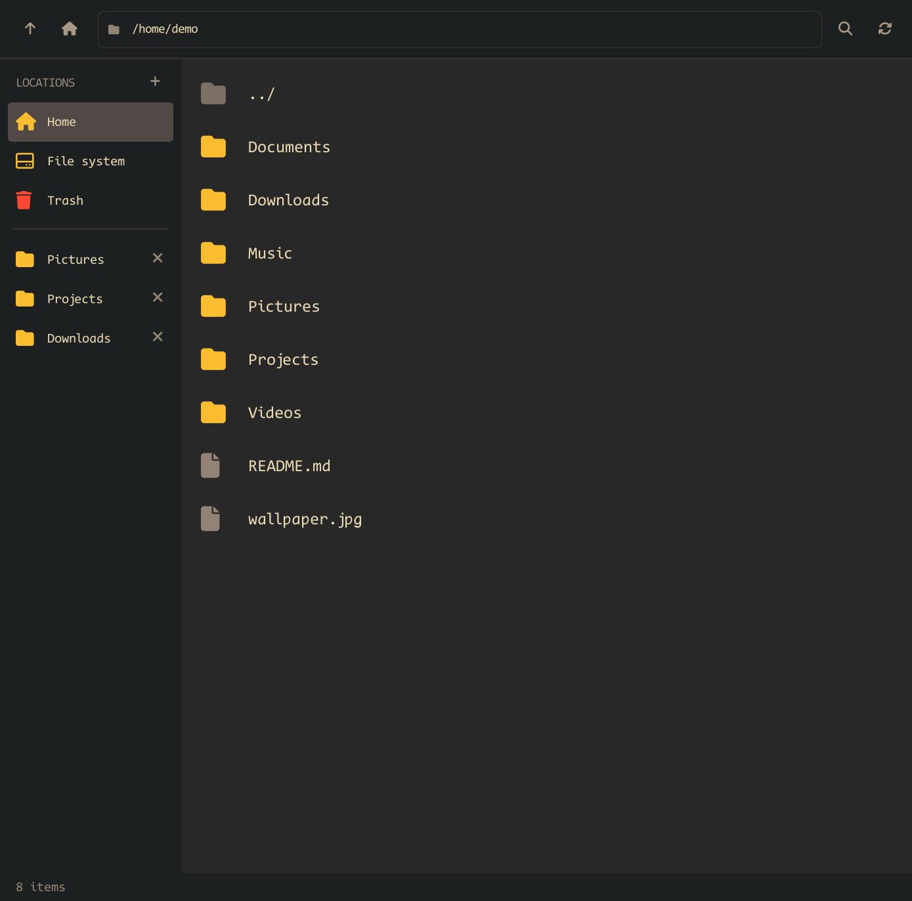

<p align="center">
  
</p>

<h1 align="center">sms</h1>
<p align="center"><b>show my stuff</b> · a minimal, very fast file explorer for Wayland</p>

<p align="center">
  
</p>

**Press `Ctrl + K`** for all keyboard shortcuts, settings (file openers, trash, archives) and the About page.

## Requirements to run

- Linux x86_64 with a **Wayland** session (no X11 / XWayland)
- OpenGL 3.3 graphics driver (Mesa or your GPU vendor's)
- `libwayland-client`, `libwayland-cursor`, `libwayland-egl`, `libxkbcommon`, `libEGL`: already present on any Wayland desktop

Optional:

- `libarchive`: browsing and extracting archives (zip, tar.*, 7z, rar, iso, …)
- `sudo`: "Retry as administrator" when permissions block an operation

## Requirements to build

- [C3](https://c3-lang.org) compiler `c3c` **0.8.x**
- a C compiler for linking (`gcc` or `clang`)
- `git`, `python3`

raylib and the UI font come with the [bmu](https://github.com/foelkdavid/bmu) submodule; nothing else to install.

## Download, build, install

```sh
git clone --recurse-submodules https://github.com/foelkdavid/sms.git
cd sms
c3c build install --trust=full
```

This installs `~/.local/bin/sms`, a desktop launcher and the icon (no sudo). Make sure `~/.local/bin` is on your
`PATH`, then run `sms` or `sms --dir ~/Downloads`.

```sh
git pull --recurse-submodules && c3c build install --trust=full   # update
c3c build uninstall --trust=full                                   # uninstall (keeps your settings)
```

Settings and saved locations live in `~/.config/sms/`.

## Built with

| | used for | license |
|---|---|---|
| [C3](https://c3-lang.org) ([c3c](https://github.com/c3lang/c3c)) | language, compiler, standard library | [compiler LGPL-3.0, standard library MIT](https://github.com/c3lang/c3c#licensing) |
| [bmu](https://github.com/foelkdavid/bmu) | UI toolkit (submodule) | [MIT](https://github.com/foelkdavid/bmu/blob/main/LICENSE) |
| [raylib](https://www.raylib.com) 6.0 | window, input, drawing (static) | [zlib](licenses/RAYLIB-LICENSE.txt) |
| [GLFW](https://www.glfw.org) 3.4 | Wayland window backend, inside raylib | [zlib](https://www.glfw.org/license.html) |
| [CodeNewRoman Nerd Font Propo](https://www.nerdfonts.com/font-downloads) | embedded UI font ([Code New Roman](https://github.com/ryanoasis/nerd-fonts/tree/master/patched-fonts/CodeNewRoman) by Sam Radian + [Nerd Fonts](https://github.com/ryanoasis/nerd-fonts) icons) | [SIL OFL 1.1](licenses/FONT-OFL.txt) |
| [libarchive](https://www.libarchive.org) | archives, optional, loaded from the system when used | [BSD-2-Clause](https://github.com/libarchive/libarchive/blob/master/COPYING) |

The font and raylib notices are in [`licenses/`](licenses/) and are installed with the app.
